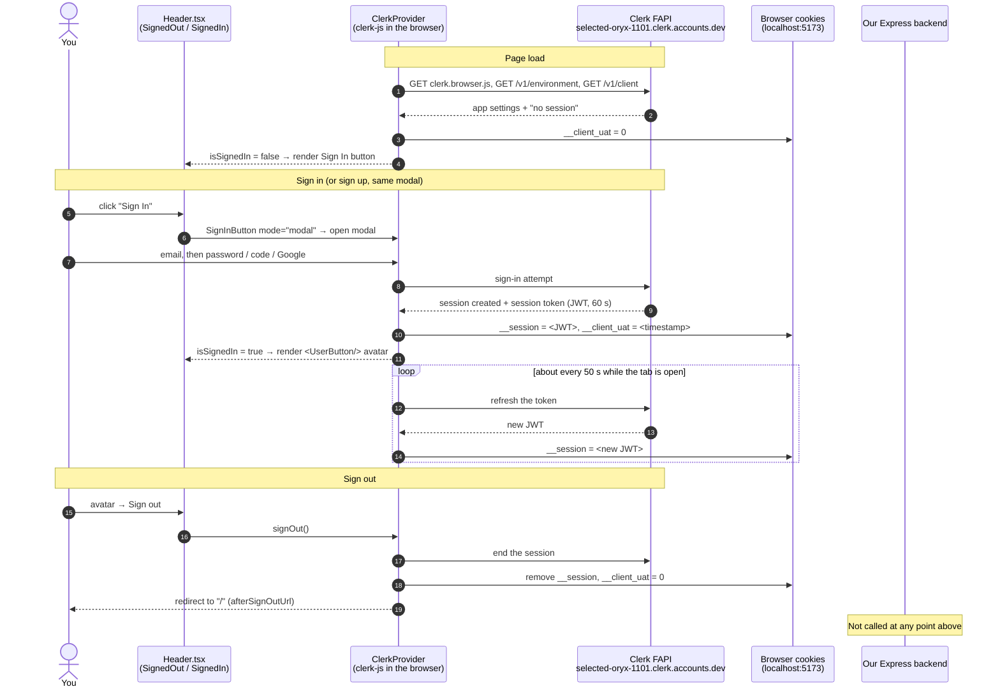

# AUTH-1 · Sign up, sign in, sign out

> **Trial lesson** (sets the standard for the rest) · Category: Auth & Users · [Feature list](FEATURES.md)
> **Time:** ~2 h (read ~35 min · trace in the code ~30 min · hands-on ~45 min)
> **By the end you can:**
> 1. Trace what happens from clicking **Sign In** to the avatar appearing, file by file, and say which parts run on **our** code and which on Clerk's.
> 2. Explain what the publishable key, the `__session` cookie and the session token are, and why the token lives only 60 seconds.
> 3. Explain why `<SignedIn>` hiding something is **not** security, and find the place in ShopMate where that mistake was made.
> 4. Decode your own session token in the browser console and read who you are from it.

---

## 🗺️ Where we are

Every feature in this app is some version of one journey. Today's twist: **sign-in leaves the journey.**

```text
   1. You click something in the UI           ◄── today starts here
   2. React component / Redux state           ◄── today
   3. API client (services/api.ts)
   4. Network → Vite proxy → Express
   5. Middleware (logger, Clerk, auth)
   6. Route → controller → service
   7. Database / external API
   8. Response → UI updates

 ► SIDE ROAD: React ⇄ Clerk's servers ⇄ browser cookies   ◄── where sign-in actually happens
```

**Today** you'll see that sign-up and sign-in never touch steps 3–7. Our backend does not see your password, does not create your account, and doesn't even know a sign-in happened.

**We stop** at a cliffhanger: Clerk knows who you are, but our Postgres `users` table doesn't. How does it find out? That's AUTH-2. And how does Express know who sent a request? That's AUTH-3.

> **How to read this lesson.** Read it in Markdown Preview with the code open beside it. Click every file link. Boxes marked 🔵 **Later** name things that belong to another lesson: notice them and move on.

---

## 🔑 Keywords

| Word | Plain meaning |
|---|---|
| **Authentication** | Proving *who* you are (sign-in). Not the same as authorization, which is *what you're allowed to do*. |
| **Identity provider / auth-as-a-service** | A company that runs sign-up, sign-in, passwords and sessions for you. Here: **Clerk**. |
| **Clerk Frontend API (FAPI)** | Clerk's server that your browser talks to directly. Ours is `selected-oryx-1101.clerk.accounts.dev`. |
| **Publishable key** | A **public** ID (`pk_test_…`) that tells the browser which Clerk app to talk to. Safe to ship to the browser. |
| **Secret key** | The **private** key (`sk_…`) only our backend may hold. Never in frontend code. |
| **Session** | Clerk's record that "this browser is signed in as this user". It lives on Clerk's servers. |
| **Session token** | A short-lived **JWT** that proves the session. Stored in the `__session` cookie. Expires after 60 seconds and is silently renewed. |
| **JWT** | JSON Web Token: three base64 pieces `header.payload.signature`. Anyone can *read* it; only the issuer can *sign* it. |
| **Provider (React)** | A component that puts a value into React context so any child can read it without passing props. |
| **Modal** | A pop-up dialog drawn over the page. |

> 🔵 **Later.** *Webhook* (AUTH-2) · *`clerkMiddleware`, `requireAuth`, `optionalAuth`* (AUTH-3) · *OAuth* (the Google/Facebook/X buttons; a later concept lesson) · *JWKS* (how a backend checks a JWT's signature, AUTH-3).

---

## Part 1 · The problem: auth is a product, not a feature

You've built auth by hand before (see your knowledgebase note *auth-lifecycle-jwt-cookies*). Count what a **complete** sign-in system needs:

```text
password hashing (bcrypt)      email verification links      password reset flow
brute-force / rate limiting    "Sign in with Google/X/FB"    session expiry + refresh
sign out everywhere            bot protection on sign-up     account deletion
multi-factor auth              leaked-password checks        a UI for all of the above
```

Each one is easy to get *almost* right, and "almost right" in auth means accounts get stolen. That is the problem Clerk solves: **we rent the whole list.**

| | Build it yourself (your old projects) | Rent it (ShopMate with Clerk) |
|---|---|---|
| Who stores passwords | Our DB (`users.password` hash) | Clerk. Our DB never sees one |
| Sign-in UI | We build forms | Clerk's `<SignInButton>` modal |
| Social login | We implement OAuth per provider | Toggle it in the Clerk dashboard |
| Sessions | Our JWT + refresh-token rotation | Clerk's 60-second token, auto-renewed |
| Cost | Our time + our security risk | Money at scale, plus vendor lock-in |
| Our backend's job | Everything | **Verify** Clerk's token and keep a copy of the user (AUTH-2, AUTH-3) |

**Why this way:** for a store, sign-in isn't the product; the kits are. Renting auth moves the riskiest code to a company whose whole job is auth.
**The cost:** our users live in someone else's system, so we need a way to **sync** them into our DB (AUTH-2) and to **trust** Clerk's tokens on every request (AUTH-3).

---

## Part 2 · 🎯 Try it first, then guess

**Do this now (2 min):**
1. At the project root, run `npm run dev --prefix frontend` and open http://localhost:5173.
2. Open DevTools (F12) → **Network** tab → tick **Preserve log**.
3. Click **Sign In** in the header. Don't sign in yet.
4. Look at the Network list: **which domains** do the new requests go to?

**Now guess before scrolling:** which of our files are involved in showing the Sign In button, opening the modal, and swapping the button for your avatar? In what order? Does any backend file run?

<details><summary><b>🎯 Check your guess: the files, in the order they run</b></summary>

| # | Where | File | What happens here |
|---|---|---|---|
| 1 | Boot | [main.tsx:14](../frontend/src/main.tsx#L14) | React starts; Redux `Provider` wraps `<App />` |
| 2 | Boot | [App.tsx:21](../frontend/src/App.tsx#L21) | Reads the publishable key from `.env` |
| 3 | Boot | [App.tsx:58](../frontend/src/App.tsx#L58) | `<ClerkProvider>` wraps the whole app and loads Clerk's JavaScript |
| 4 | UI | [Header.tsx:220](../frontend/src/components/layout/Header.tsx#L220) | `<SignedOut>` shows the Sign In button; `<SignedIn>` shows the avatar |
| 5 | Clerk | *(Clerk's code, not ours)* | The modal talks to `selected-oryx-1101.clerk.accounts.dev` |
| 6 | UI | [AccountPage.tsx:16](../frontend/src/pages/AccountPage.tsx#L16) | `useUser()` reads the signed-in user's name and email |

**Backend files involved: none.** No file in `backend/` runs during sign-up, sign-in or sign-out. If you guessed `auth.controller.ts`, that's the natural guess (and it's how your previous projects worked), but here it only runs for the webhook in AUTH-2.

</details>

---

## Part 3 · 🗺️ The flow



**In plain words:** `ClerkProvider` loads Clerk's own JavaScript (clerk-js) from Clerk's servers. That script draws the modal, sends your credentials straight to Clerk, and stores the result in cookies on *our* domain. Every Clerk component (`<SignedIn>`, `<UserButton>`, `useUser()`) just reads that state and re-renders. Our backend appears in the diagram only to show that nothing reaches it.

---

## Part 4 · 🔍 The trace

#### Step 1 · React boots with Redux outside, Clerk inside
[main.tsx:14](../frontend/src/main.tsx#L14)

```tsx
createRoot(rootElement).render(
  <StrictMode>
    <Provider store={store}>
      <App />
    </Provider>
  </StrictMode>
)
```

**What it does:** mounts React and wraps everything in the Redux store. Clerk is *not* here; it's added one level down inside `App`.
**Why it's built this way:** both orders work. Putting Redux outermost means even Clerk's subtree can use Redux, and keeps `main.tsx` free of env-dependent logic.
**Without it:** any `useAppSelector` call would throw "could not find react-redux context value".

#### Step 2 · The publishable key comes from `.env`
[App.tsx:21](../frontend/src/App.tsx#L21)

```tsx
const clerkPubKey = import.meta.env.VITE_CLERK_PUBLISHABLE_KEY || '';
```

**What it does:** Vite replaces `import.meta.env.VITE_…` with the value from `frontend/.env` when it serves (dev) or builds (production) the code, so the value is baked into the JavaScript the browser downloads. Only variables starting with `VITE_` are exposed to the browser; that prefix is Vite's safety rule against leaking secrets.
**Why it's safe here:** a publishable key is public by design. It's not a password; it's an address. Watch:

```text
pk_test_ + base64("selected-oryx-1101.clerk.accounts.dev$")
          └── decoded from your real key on 2026-10-21
```

The `test` part means a **development instance**; production keys start with `pk_live_`. The rest is just the FAPI domain, base64-encoded. That's how clerk-js knows where to send requests.
**Without it:** see 💥 Break it #1. It's worse than you'd expect.

#### Step 3 · `ClerkProvider` wraps the app (with a broken fallback)
[App.tsx:58](../frontend/src/App.tsx#L58)

```tsx
export const App: React.FC = () => {
  if (clerkPubKey) {
    return (
      <ClerkProvider publishableKey={clerkPubKey}>
        <BrowserRouter>
          <MainLayout />
        </BrowserRouter>
      </ClerkProvider>
    );
  }

  return (
    <BrowserRouter>
      <MainLayout />
    </BrowserRouter>
  );
};
```

**What it does:** `ClerkProvider` downloads clerk-js from your FAPI domain, asks Clerk "is this browser signed in?" (`GET /v1/client`), and puts the answer into **React context**. Every Clerk component below reads from that context.
**Why a Provider:** auth state is needed in many unrelated places (Header, AccountPage, Checkout). Context avoids passing `user` through every component's props. This is the same pattern as Redux's `<Provider>` in Step 1.
**The intent of the `if`:** "if there's no key, run the app without auth". **It doesn't work**: `Header` uses `<SignedIn>`, which throws outside a `ClerkProvider`, and the whole page goes blank. The fallback branch was never tested. (You'll prove it in Break it #1.)

#### Step 4 · The header swaps button ↔ avatar
[Header.tsx:220](../frontend/src/components/layout/Header.tsx#L220)

```tsx
{/* Clerk User Button / Sign In */}
<div className="flex items-center pl-1 sm:pl-2 border-l border-[var(--border-subtle)] shrink-0">
  <SignedIn>
    <UserButton afterSignOutUrl="/" />
  </SignedIn>
  <SignedOut>
    <SignInButton mode="modal">
      <button className="...">
        <UserIcon className="w-4 h-4" />
        <span className="hidden sm:inline whitespace-nowrap">Sign In</span>
      </button>
    </SignInButton>
  </SignedOut>
</div>
```

**What it does:**
- `<SignedIn>` / `<SignedOut>` render their children only in that state. They render **nothing** while Clerk is still loading, which avoids a flash of the wrong button.
- `<SignInButton mode="modal">` wraps *our* styled `<button>` and adds the click handler that opens Clerk's modal. Without `mode="modal"` it would redirect to a Clerk-hosted page instead.
- `<UserButton>` is the avatar menu (manage account, sign out). `afterSignOutUrl="/"` sends you home after signing out.

**Why it's built this way:** the modal keeps you on the product page you were looking at. A redirect would lose your place.
**Where's "Sign up"?** There's no separate button. The modal's footer link "Don't have an account? Sign up" switches it into sign-up mode. Same component, same flow.

#### Step 5 · Clerk takes over (not our code)

When you submit the modal, clerk-js talks to the FAPI domain directly. On 2026-10-21, with the modal open, the only new requests went to `selected-oryx-1101.clerk.accounts.dev/v1/...`. **Zero requests to `/api/...`.** Your password never passes through anything we wrote.

#### Step 6 · Pages read the user from context
[AccountPage.tsx:15](../frontend/src/pages/AccountPage.tsx#L15)

```tsx
export const AccountPage: React.FC = () => {
  const { user } = useUser();
  // ...
  useEffect(() => {
    let isCurrent = true;
    if (user?.primaryEmailAddress?.emailAddress) {
      setIsLoading(true);
      fetchUserOrdersApi(user.primaryEmailAddress.emailAddress)
```

**What it does:** `useUser()` reads the user object Clerk put in context: name, image, email. No request to our backend is needed to show your name and avatar. Then it asks our backend for orders **by email**.
**Why it matters:** this is the first point where Clerk's world touches ours, and it's done in a risky way. See Part 5.

---

## Part 5 · ⚠️ Reality check: hiding a button is not security

Look at what the frontend sends for "my orders", and what the backend does with it:

[api.ts:312](../frontend/src/services/api.ts#L312)

```ts
export async function fetchUserOrdersApi(guestEmail?: string, token?: string | null): Promise<OrderModel[]> {
  const query = guestEmail ? `?email=${encodeURIComponent(guestEmail)}` : '';
  const res = await fetch(`${API_BASE_URL}/api/orders${query}`, {
```

[payment.controller.ts:68](../backend/src/modules/payments/payment.controller.ts#L68)

```ts
export const getUserOrders = asyncHandler(async (req: Request, res: Response) => {
  const userId = req.user?.id || (req.headers['x-user-id'] as string) || undefined;
  const guestEmail = (req.query.email as string) || undefined;

  const orders = await paymentService.getUserOrders(userId, guestEmail);
```

The account page only shows your orders **after** `<SignedIn>` and `useUser()`. That feels protected. But the backend never checks that the email belongs to the person asking. Anyone can type this in a terminal, signed in or not:

```bash
curl "http://localhost:5000/api/orders?email=someone-else@gmail.com"
```

…and get that person's orders, including the `shippingAddress` stored on each one. The `x-user-id` header is just as open: the backend trusts whatever ID the caller sends.

> **The rule:** `<SignedIn>`, `useUser()` and hidden buttons are **UI decisions**. Anyone can skip the UI and call the API directly. Every protected decision must be made **on the server**, from a token the server verifies itself. That's exactly what AUTH-3 (`requireAuth`) is for.
>
> *Predicted from the code, not run:* the backend wasn't running on 2026-10-21. You'll confirm it in AUTH-3, then decide how to fix it.

---

## Part 6 · 🧠 Concepts

### 6.1 Sessions with a 60-second token

**The problem:** a token that lives for days is a disaster if it leaks, because nobody can cancel it. A token that lives for minutes means signing in again and again.

**Clerk's answer, in two layers:**

```text
  Long-lived:  the SESSION on Clerk's servers (days/weeks). Can be revoked any time.
                 │ proven to Clerk by a long-lived cookie (production: __client, HttpOnly,
                 │ on Clerk's domain; development: the __clerk_db_jwt "dev browser" token)
                 ▼
  Short-lived: the SESSION TOKEN (JWT) in __session on OUR domain. Expires in 60 s.
               clerk-js quietly fetches a new one about every 50 s.
```

A leaked `__session` is useless a minute later. Revoking the session (sign out everywhere, ban a user) takes effect within a minute, because no new token gets issued.

**Compared to what you built before** (access token + refresh token in your knowledgebase note): it's the same idea. Clerk's "refresh token" is the long-lived Clerk cookie, and the refresh runs automatically in clerk-js instead of in your Axios interceptor.

**Trade-off:** `__session` is **not HttpOnly**, because clerk-js has to write it from JavaScript. So an XSS bug *could* read it. Clerk accepts that risk because the token dies in 60 seconds. Your own note recommends HttpOnly; this is a deliberate, different trade-off, and a great interview discussion.

### 6.2 Cookies you can see right now

Captured on 2026-10-21 at `localhost:5173`, **signed out**:

```text
__clerk_db_jwt      = dvb_3K…   ← dev-only "browser identity", ties this browser to Clerk's dev instance
__client_uat        = 0         ← "client updated at": 0 means no signed-in user
__session           (absent)    ← no session token, because nobody is signed in
__stripe_mid / __stripe_sid     ← Stripe.js, unrelated to auth
```

Why the dev-only cookie? In development your app (`localhost`) and Clerk (`*.clerk.accounts.dev`) are different sites, and browsers block cross-site cookies. So Clerk sends a "dev browser" token in the URL and a cookie instead. In production you point a subdomain like `clerk.yourshop.com` at Clerk, so its cookies count as first-party.

### 6.3 Authentication state is UI state; authorization is server state

| | Lives in | Decides | Can a user bypass it? |
|---|---|---|---|
| `<SignedIn>`, `useUser()` | Browser (React context) | What to **show** | Yes: DevTools, curl, Postman |
| `requireAuth` + token check (AUTH-3) | Server | What to **allow** | No, if the token is verified |

> 🧰 **Clerk** · *What problem:* running sign-up, sign-in, sessions and user management as a service. · *Without it:* everything in Part 1's list is ours to build and secure. · *Used here:* [App.tsx:58](../frontend/src/App.tsx#L58) (`ClerkProvider`), [Header.tsx:220](../frontend/src/components/layout/Header.tsx#L220) (`SignedIn/Out`, `SignInButton`, `UserButton`), [AccountPage.tsx:16](../frontend/src/pages/AccountPage.tsx#L16) (`useUser`), and in the backend [app.ts:33](../backend/src/app.ts#L33) (`clerkMiddleware`, AUTH-3). · *Gotcha:* every Clerk component **must** be inside `ClerkProvider`, or the app crashes (Break it #1).

---

## Part 7 · 🎯 Hands-on: see it with your own eyes

One experiment at a time. Do one, reply with what I ask, then move on.

**Experiment 1 · Signed-out cookies.** Two windows: the app tab, and DevTools.
1. DevTools → **Application** tab → left side **Cookies** → `http://localhost:5173`.
2. Find `__client_uat` and check whether `__session` exists.
3. **Reply with:** the value of `__client_uat`, and whether `__session` is there.

**Experiment 2 · Sign in and watch.**
1. DevTools → **Network** → filter box: `clerk.accounts.dev`. Clear the list (🚫).
2. Sign in (or sign up) through the modal.
3. **Reply with:** the request paths you see (just the part after `/v1/`), and whether *any* request went to `/api/`.

**Experiment 3 · Read your own token.**
1. Back in Application → Cookies: copy the value of `__session`.
2. DevTools → **Console**, paste this (replace TOKEN; keep the quotes):
   ```js
   JSON.parse(atob('TOKEN'.split('.')[1].replace(/-/g,'+').replace(/_/g,'/')))
   ```
   Decode it locally like this rather than pasting it into a website: a token is a credential.
3. **Reply with:** the `sub` value (does it start with `user_`?), and `exp − iat` (how many seconds the token lives).
4. Wait two minutes, look at `__session` again. **Reply with:** did the value change?

**Experiment 4 · Sign out.**
1. Avatar → Sign out.
2. **Reply with:** the `__client_uat` value now, and whether `__session` still exists.

---

## Part 8 · 💥 Break it

**#1 · Remove the key** (verified on 2026-10-21)
1. In `frontend/.env`, change the line to `VITE_CLERK_PUBLISHABLE_KEY=` (empty). Restart `npm run dev --prefix frontend`.
2. **Predict first:** does the app run without auth, as the `if` in [App.tsx:58](../frontend/src/App.tsx#L58) intended?

<details><summary>What happens</summary>

A completely blank page. Console:

```text
Uncaught Error: @clerk/clerk-react: SignedIn can only be used within the <ClerkProvider /> component.
```

The fallback branch renders `MainLayout` without `ClerkProvider`, but `Header` still uses `<SignedIn>`. One uncaught error during render unmounts the whole React tree. **Lesson:** a "graceful fallback" that was never tested is a crash waiting for a missing env var, and that's a common production incident (a deploy forgets one variable).

</details>

3. Put the key back: `git restore` won't help here because `.env` isn't tracked, so undo your edit by hand and restart.

**#2 · Drop `mode="modal"`**
1. In [Header.tsx:226](../frontend/src/components/layout/Header.tsx#L226) change `<SignInButton mode="modal">` to `<SignInButton>`. Save (Vite reloads).
2. **Predict:** what happens when you click Sign In, and where does the URL bar point?

<details><summary>What happens</summary>

Instead of a pop-up, you're redirected to Clerk's hosted sign-in page, a URL on Clerk's `accounts.dev` domain. After signing in, Clerk redirects you back. Same auth, different user experience: you leave the page you were on.
*(Predicted from Clerk's docs, not run: it needs a sign-in, which only you can do.)*

</details>

3. Revert: `git restore frontend/src/components/layout/Header.tsx`

---

## Part 9 · 🔨 Rebuild: the header auth block with hooks

`<SignedIn>` / `<SignedOut>` hide the loading state from you. Rewriting them with the `useAuth()` hook shows what they do inside.

**Spec:**
- In [Header.tsx](../frontend/src/components/layout/Header.tsx), replace the `<SignedIn>`/`<SignedOut>` block (lines 222–232) with code that uses `const { isLoaded, isSignedIn } = useAuth();` from `@clerk/clerk-react`.
- While `!isLoaded`: render a small grey circle placeholder (same size as the avatar).
- Signed in: `<UserButton afterSignOutUrl="/" />`. Signed out: the same `<SignInButton mode="modal">` + button.
- **Check:** reload the page with DevTools → Network → throttling "Slow 4G". You should see your placeholder for a moment, then the right control. No flash of "Sign In" for a signed-in user.

<details><summary>Hint 1</summary>A ternary chain works: <code>!isLoaded ? placeholder : isSignedIn ? avatar : button</code>.</details>
<details><summary>Hint 2</summary>For the placeholder, reuse the sizing classes from the avatar area: a <code>div</code> with <code>w-7 h-7 rounded-full</code> and a muted background token like <code>bg-[var(--border-subtle)]</code>.</details>
<details><summary>Approach</summary>Import <code>useAuth</code> next to the existing Clerk imports on line 17, call it at the top of the component next to the other hooks, then replace the JSX block. Hooks must be called at the top level of the component, never inside the JSX conditions.</details>

When you're done, show me the diff and I'll review it. Then `git restore` it, or keep it if you like it better.

---

## 🎤 Interview angle

<details><summary><b>"How does authentication work in your project?" (60-second answer)</b></summary>

"We use Clerk as the identity provider, so sign-up, sign-in, social login and sessions don't run on our servers. On the frontend, `ClerkProvider` loads Clerk's SDK with a public publishable key, and Clerk's components handle the UI. After sign-in, Clerk issues a 60-second session JWT into a `__session` cookie and refreshes it in the background, while the long-lived session stays on Clerk's side, so it can be revoked. Our backend never sees passwords. It verifies the JWT on each request with Clerk's middleware, and it keeps its own `users` table in sync through a signed Clerk webhook, so orders and carts can reference a local user ID. The key design rule is that frontend auth state only controls what we *show*; every access decision is made on the server from the verified token."

</details>

**Likely follow-ups:**
1. *"Why not HttpOnly cookies for the token?"* → Part 6.1 trade-off: clerk-js must write it; 60 s expiry limits the damage.
2. *"What happens if Clerk is down?"* → Nobody can sign in, and token refresh fails within about a minute, so signed-in users effectively drop to guest. Vendor dependency is the price of renting auth.

---

## ⚠️ Common confusions

- **"Sign-up creates a row in our database."** Not directly. Clerk creates the user; our DB only learns about it through a webhook (AUTH-2). If the webhook isn't set up, the user exists in Clerk but not in `users`.
- **"The publishable key is a secret, it's in `.env`."** `.env` holds both kinds of values. The `VITE_` prefix means "ship this to the browser", so anything with that prefix is public by definition. The **secret** key lives only in `backend/.env`.
- **"Signed in on the frontend = authorized on the backend."** No. The backend decides for itself from the token (AUTH-3). Part 5 shows what happens when it doesn't.
- **"Sign in and sign up are different features."** In Clerk they're one modal with a toggle, and both end in the same result: a session.
- **"The token in `__session` is my session."** The token is a 60-second *proof* of the session. The session itself lives on Clerk's servers.

---

## 🧪 Active recall

1. You click **Sign In** and type your password. Which machines see that password? Which of our files run?
   <details><summary>Answer</summary>Only your browser (clerk-js) and Clerk's FAPI (<code>selected-oryx-1101.clerk.accounts.dev</code>). None of our backend files run. On the frontend, only our <code>Header</code> runs, to render the button that opens the modal.</details>

2. Why is it safe to ship `pk_test_…` to every browser, but a disaster to ship `sk_…`?
   <details><summary>Answer</summary>The publishable key only identifies which Clerk app to talk to (it's the FAPI domain, base64-encoded). The secret key lets the holder act as our backend: read and change any user, verify and create sessions. Anyone could take over the user base.</details>

3. **Diagnose:** after a deploy, the site is a white page and the console says "SignedIn can only be used within the &lt;ClerkProvider /&gt;". What's the most likely cause, and which file has the bug that made it a crash instead of a degraded app?
   <details><summary>Answer</summary><code>VITE_CLERK_PUBLISHABLE_KEY</code> was missing at build time. <code>App.tsx</code> falls back to rendering without <code>ClerkProvider</code>, but <code>Header.tsx</code> still uses <code>&lt;SignedIn&gt;</code>, which throws.</details>

4. A teammate says: "The orders endpoint is safe; you can only see orders on the account page after signing in." What do you show them?
   <details><summary>Answer</summary>A <code>curl "/api/orders?email=…"</code> (or an <code>x-user-id</code> header) with no session at all. The backend never checks who's asking (<code>payment.controller.ts:68</code>). UI gating isn't access control.</details>

5. Why does Clerk's session token live only 60 seconds, and what keeps you signed in for days anyway?
   <details><summary>Answer</summary>A short token limits the damage if it leaks, and revocations take effect within a minute. The long-lived session on Clerk's servers (proven by the <code>__client</code> cookie in production, or the dev-browser token in development) lets clerk-js fetch a fresh token about every 50 seconds.</details>

---

## Close the loop

**Now on the map:** steps 1–2 for auth are understood. Sign-in is a **side road** to Clerk, and our backend isn't on it.

**Two questions are left open, and they're the next two lessons:**
- Clerk knows you, but our Postgres `users` table doesn't. Orders and carts need a `userId` from **our** DB. **How does a new Clerk user end up in our table?** → **AUTH-2: the Clerk webhook.** (Spoiler from the scan: `backend/.env` has no `CLERK_WEBHOOK_SECRET`, so this sync may not be working at all. We'll find out.)
- When the cart calls `GET /api/cart`, **how does Express know who you are?** The frontend never sends a token header. → **AUTH-3: `clerkMiddleware` and the `__session` cookie through the Vite proxy.**

---
*Lesson data: [captures/2026-10-21-auth1-signed-out.md](captures/2026-10-21-auth1-signed-out.md) · code at commit `0b5e898`*
