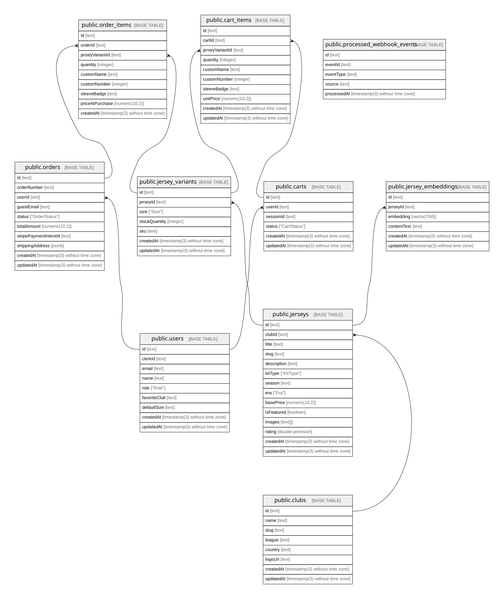

# ShopMate AI

## Tables

| Name                                                                  | Columns | Comment | Type       |
| --------------------------------------------------------------------- | ------- | ------- | ---------- |
| [public.users](public.users.md)                                       | 9       |         | BASE TABLE |
| [public.clubs](public.clubs.md)                                       | 8       |         | BASE TABLE |
| [public.jerseys](public.jerseys.md)                                   | 14      |         | BASE TABLE |
| [public.jersey_variants](public.jersey_variants.md)                   | 7       |         | BASE TABLE |
| [public.jersey_embeddings](public.jersey_embeddings.md)               | 6       |         | BASE TABLE |
| [public.carts](public.carts.md)                                       | 6       |         | BASE TABLE |
| [public.cart_items](public.cart_items.md)                             | 10      |         | BASE TABLE |
| [public.orders](public.orders.md)                                     | 10      |         | BASE TABLE |
| [public.order_items](public.order_items.md)                           | 9       |         | BASE TABLE |
| [public.processed_webhook_events](public.processed_webhook_events.md) | 5       |         | BASE TABLE |

## Enums

| Name               | Values                                        |
| ------------------ | --------------------------------------------- |
| public.CartStatus  | ABANDONED, ACTIVE, CONVERTED                  |
| public.Era         | MODERN, RETRO                                 |
| public.KitType     | AWAY, GOALKEEPER, HOME, RETRO, THIRD          |
| public.OrderStatus | CANCELLED, PAID, PENDING, PROCESSING, SHIPPED |
| public.Role        | ADMIN, CUSTOMER                               |
| public.Size        | L, M, S, XL, XXL                              |

## Relations

---

> Generated by [tbls](https://github.com/k1LoW/tbls)
