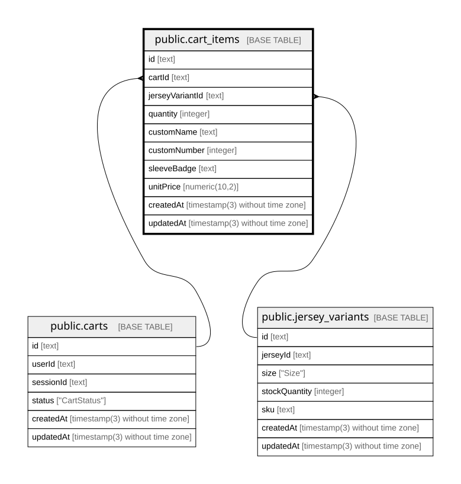

# public.cart_items

## Columns

| Name            | Type                           | Default           | Nullable | Children | Parents                                             | Comment |
| --------------- | ------------------------------ | ----------------- | -------- | -------- | --------------------------------------------------- | ------- |
| id              | text                           |                   | false    |          |                                                     |         |
| cartId          | text                           |                   | false    |          | [public.carts](public.carts.md)                     |         |
| jerseyVariantId | text                           |                   | false    |          | [public.jersey_variants](public.jersey_variants.md) |         |
| quantity        | integer                        | 1                 | false    |          |                                                     |         |
| customName      | text                           |                   | true     |          |                                                     |         |
| customNumber    | integer                        |                   | true     |          |                                                     |         |
| sleeveBadge     | text                           |                   | true     |          |                                                     |         |
| unitPrice       | numeric(10,2)                  |                   | false    |          |                                                     |         |
| createdAt       | timestamp(3) without time zone | CURRENT_TIMESTAMP | false    |          |                                                     |         |
| updatedAt       | timestamp(3) without time zone |                   | false    |          |                                                     |         |

## Constraints

| Name                            | Type        | Definition                                                                                         |
| ------------------------------- | ----------- | -------------------------------------------------------------------------------------------------- |
| cart_items_jerseyVariantId_fkey | FOREIGN KEY | FOREIGN KEY ("jerseyVariantId") REFERENCES jersey_variants(id) ON UPDATE CASCADE ON DELETE CASCADE |
| cart_items_cartId_fkey          | FOREIGN KEY | FOREIGN KEY ("cartId") REFERENCES carts(id) ON UPDATE CASCADE ON DELETE CASCADE                    |
| cart_items_pkey                 | PRIMARY KEY | PRIMARY KEY (id)                                                                                   |

## Indexes

| Name                                                            | Definition                                                                                                                                                                                        |
| --------------------------------------------------------------- | ------------------------------------------------------------------------------------------------------------------------------------------------------------------------------------------------- |
| cart_items_pkey                                                 | CREATE UNIQUE INDEX cart_items_pkey ON public.cart_items USING btree (id)                                                                                                                         |
| cart_items_cartId_jerseyVariantId_customName_customNumber_s_key | CREATE UNIQUE INDEX "cart_items_cartId_jerseyVariantId_customName_customNumber_s_key" ON public.cart_items USING btree ("cartId", "jerseyVariantId", "customName", "customNumber", "sleeveBadge") |

## Relations

---

> Generated by [tbls](https://github.com/k1LoW/tbls)
