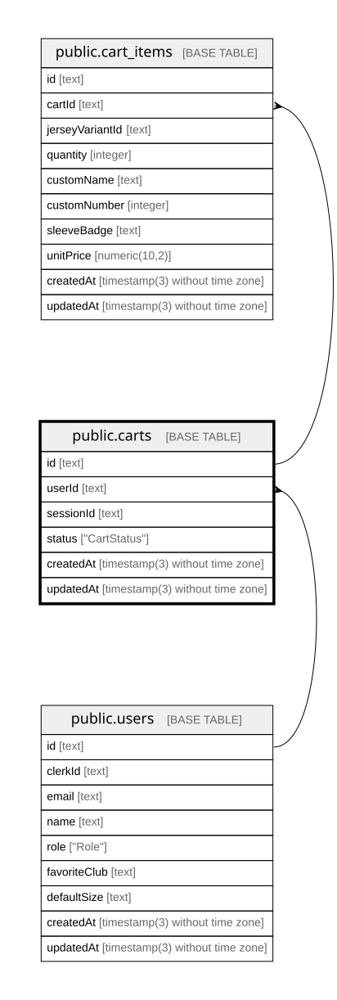

# public.carts

## Columns

| Name      | Type                           | Default                | Nullable | Children                                  | Parents                         | Comment |
| --------- | ------------------------------ | ---------------------- | -------- | ----------------------------------------- | ------------------------------- | ------- |
| id        | text                           |                        | false    | [public.cart_items](public.cart_items.md) |                                 |         |
| userId    | text                           |                        | true     |                                           | [public.users](public.users.md) |         |
| sessionId | text                           |                        | true     |                                           |                                 |         |
| status    | "CartStatus"                   | 'ACTIVE'::"CartStatus" | false    |                                           |                                 |         |
| createdAt | timestamp(3) without time zone | CURRENT_TIMESTAMP      | false    |                                           |                                 |         |
| updatedAt | timestamp(3) without time zone |                        | false    |                                           |                                 |         |

## Constraints

| Name              | Type        | Definition                                                                       |
| ----------------- | ----------- | -------------------------------------------------------------------------------- |
| carts_userId_fkey | FOREIGN KEY | FOREIGN KEY ("userId") REFERENCES users(id) ON UPDATE CASCADE ON DELETE SET NULL |
| carts_pkey        | PRIMARY KEY | PRIMARY KEY (id)                                                                 |

## Indexes

| Name                | Definition                                                                          |
| ------------------- | ----------------------------------------------------------------------------------- |
| carts_pkey          | CREATE UNIQUE INDEX carts_pkey ON public.carts USING btree (id)                     |
| carts_sessionId_key | CREATE UNIQUE INDEX "carts_sessionId_key" ON public.carts USING btree ("sessionId") |
| carts_userId_idx    | CREATE INDEX "carts_userId_idx" ON public.carts USING btree ("userId")              |

## Relations

---

> Generated by [tbls](https://github.com/k1LoW/tbls)
