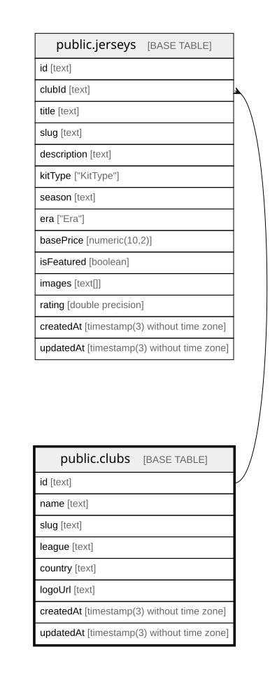

# public.clubs

## Columns

| Name      | Type                           | Default           | Nullable | Children                            | Parents | Comment |
| --------- | ------------------------------ | ----------------- | -------- | ----------------------------------- | ------- | ------- |
| id        | text                           |                   | false    | [public.jerseys](public.jerseys.md) |         |         |
| name      | text                           |                   | false    |                                     |         |         |
| slug      | text                           |                   | false    |                                     |         |         |
| league    | text                           |                   | false    |                                     |         |         |
| country   | text                           |                   | false    |                                     |         |         |
| logoUrl   | text                           |                   | true     |                                     |         |         |
| createdAt | timestamp(3) without time zone | CURRENT_TIMESTAMP | false    |                                     |         |         |
| updatedAt | timestamp(3) without time zone |                   | false    |                                     |         |         |

## Constraints

| Name       | Type        | Definition       |
| ---------- | ----------- | ---------------- |
| clubs_pkey | PRIMARY KEY | PRIMARY KEY (id) |

## Indexes

| Name             | Definition                                                            |
| ---------------- | --------------------------------------------------------------------- |
| clubs_pkey       | CREATE UNIQUE INDEX clubs_pkey ON public.clubs USING btree (id)       |
| clubs_slug_key   | CREATE UNIQUE INDEX clubs_slug_key ON public.clubs USING btree (slug) |
| clubs_league_idx | CREATE INDEX clubs_league_idx ON public.clubs USING btree (league)    |

## Relations

---

> Generated by [tbls](https://github.com/k1LoW/tbls)
