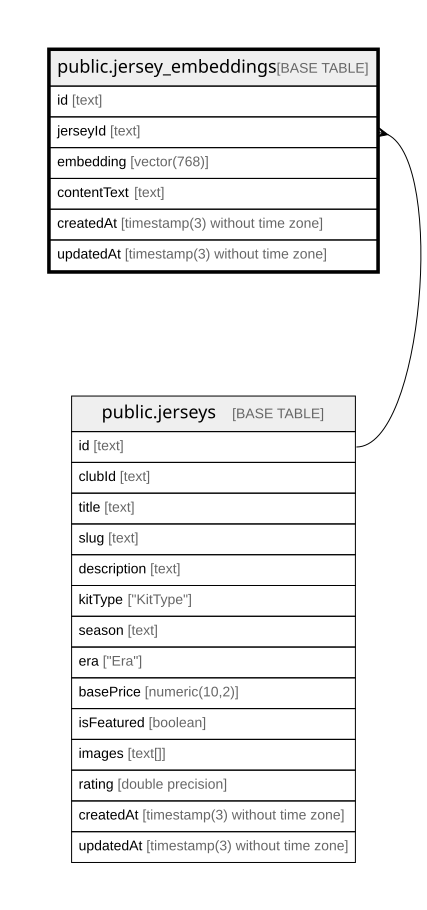

# public.jersey_embeddings

## Columns

| Name        | Type                           | Default           | Nullable | Children | Parents                             | Comment |
| ----------- | ------------------------------ | ----------------- | -------- | -------- | ----------------------------------- | ------- |
| id          | text                           |                   | false    |          |                                     |         |
| jerseyId    | text                           |                   | false    |          | [public.jerseys](public.jerseys.md) |         |
| embedding   | vector(768)                    |                   | false    |          |                                     |         |
| contentText | text                           |                   | false    |          |                                     |         |
| createdAt   | timestamp(3) without time zone | CURRENT_TIMESTAMP | false    |          |                                     |         |
| updatedAt   | timestamp(3) without time zone |                   | false    |          |                                     |         |

## Constraints

| Name                            | Type        | Definition                                                                          |
| ------------------------------- | ----------- | ----------------------------------------------------------------------------------- |
| jersey_embeddings_jerseyId_fkey | FOREIGN KEY | FOREIGN KEY ("jerseyId") REFERENCES jerseys(id) ON UPDATE CASCADE ON DELETE CASCADE |
| jersey_embeddings_pkey          | PRIMARY KEY | PRIMARY KEY (id)                                                                    |

## Indexes

| Name                                 | Definition                                                                                                             |
| ------------------------------------ | ---------------------------------------------------------------------------------------------------------------------- |
| jersey_embeddings_pkey               | CREATE UNIQUE INDEX jersey_embeddings_pkey ON public.jersey_embeddings USING btree (id)                                |
| jersey_embeddings_jerseyId_key       | CREATE UNIQUE INDEX "jersey_embeddings_jerseyId_key" ON public.jersey_embeddings USING btree ("jerseyId")              |
| jersey_embeddings_embedding_hnsw_idx | CREATE INDEX jersey_embeddings_embedding_hnsw_idx ON public.jersey_embeddings USING hnsw (embedding vector_cosine_ops) |

## Relations

---

> Generated by [tbls](https://github.com/k1LoW/tbls)
