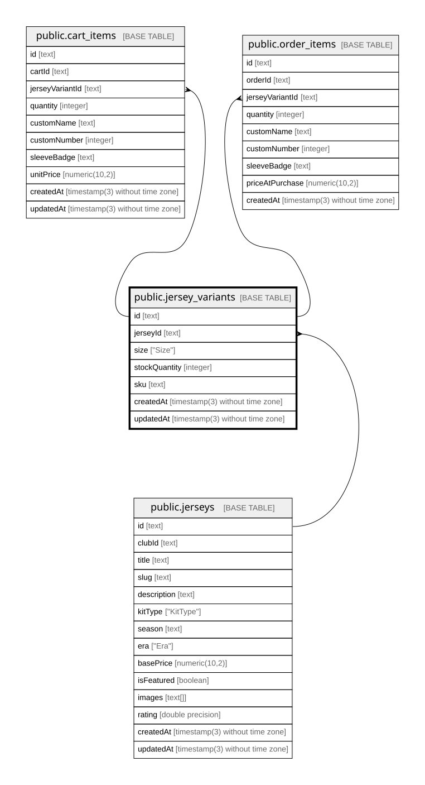

# public.jersey_variants

## Columns

| Name          | Type                           | Default           | Nullable | Children                                                                              | Parents                             | Comment |
| ------------- | ------------------------------ | ----------------- | -------- | ------------------------------------------------------------------------------------- | ----------------------------------- | ------- |
| id            | text                           |                   | false    | [public.cart_items](public.cart_items.md) [public.order_items](public.order_items.md) |                                     |         |
| jerseyId      | text                           |                   | false    |                                                                                       | [public.jerseys](public.jerseys.md) |         |
| size          | "Size"                         |                   | false    |                                                                                       |                                     |         |
| stockQuantity | integer                        | 0                 | false    |                                                                                       |                                     |         |
| sku           | text                           |                   | false    |                                                                                       |                                     |         |
| createdAt     | timestamp(3) without time zone | CURRENT_TIMESTAMP | false    |                                                                                       |                                     |         |
| updatedAt     | timestamp(3) without time zone |                   | false    |                                                                                       |                                     |         |

## Constraints

| Name                          | Type        | Definition                                                                          |
| ----------------------------- | ----------- | ----------------------------------------------------------------------------------- |
| jersey_variants_jerseyId_fkey | FOREIGN KEY | FOREIGN KEY ("jerseyId") REFERENCES jerseys(id) ON UPDATE CASCADE ON DELETE CASCADE |
| jersey_variants_pkey          | PRIMARY KEY | PRIMARY KEY (id)                                                                    |

## Indexes

| Name                              | Definition                                                                                                       |
| --------------------------------- | ---------------------------------------------------------------------------------------------------------------- |
| jersey_variants_pkey              | CREATE UNIQUE INDEX jersey_variants_pkey ON public.jersey_variants USING btree (id)                              |
| jersey_variants_sku_key           | CREATE UNIQUE INDEX jersey_variants_sku_key ON public.jersey_variants USING btree (sku)                          |
| jersey_variants_jerseyId_size_key | CREATE UNIQUE INDEX "jersey_variants_jerseyId_size_key" ON public.jersey_variants USING btree ("jerseyId", size) |

## Relations

---

> Generated by [tbls](https://github.com/k1LoW/tbls)
