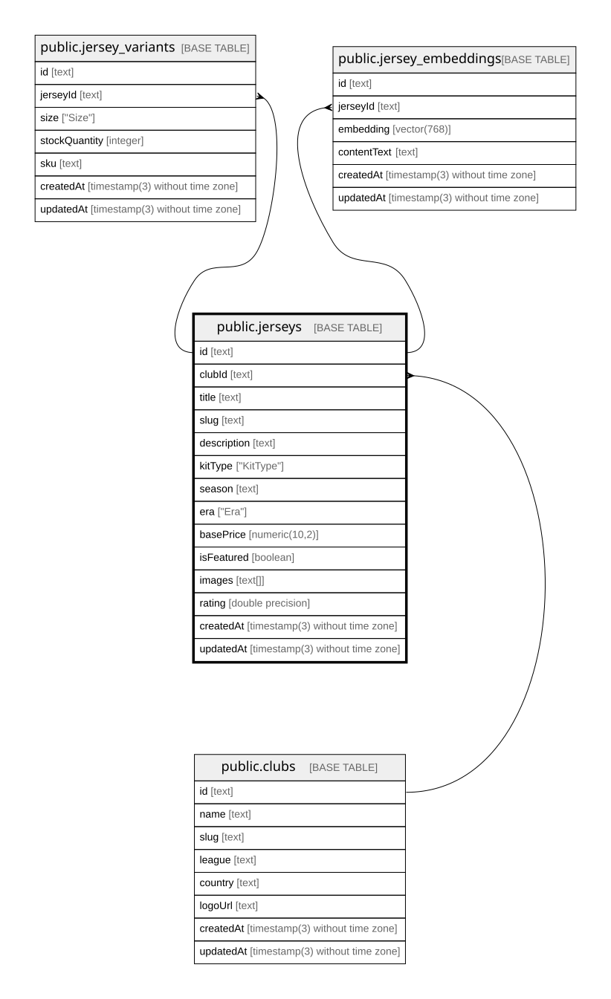

# public.jerseys

## Columns

| Name        | Type                           | Default           | Nullable | Children                                                                                                    | Parents                         | Comment |
| ----------- | ------------------------------ | ----------------- | -------- | ----------------------------------------------------------------------------------------------------------- | ------------------------------- | ------- |
| id          | text                           |                   | false    | [public.jersey_variants](public.jersey_variants.md) [public.jersey_embeddings](public.jersey_embeddings.md) |                                 |         |
| clubId      | text                           |                   | false    |                                                                                                             | [public.clubs](public.clubs.md) |         |
| title       | text                           |                   | false    |                                                                                                             |                                 |         |
| slug        | text                           |                   | false    |                                                                                                             |                                 |         |
| description | text                           |                   | false    |                                                                                                             |                                 |         |
| kitType     | "KitType"                      |                   | false    |                                                                                                             |                                 |         |
| season      | text                           |                   | false    |                                                                                                             |                                 |         |
| era         | "Era"                          | 'MODERN'::"Era"   | false    |                                                                                                             |                                 |         |
| basePrice   | numeric(10,2)                  |                   | false    |                                                                                                             |                                 |         |
| isFeatured  | boolean                        | false             | false    |                                                                                                             |                                 |         |
| images      | text[]                         |                   | true     |                                                                                                             |                                 |         |
| rating      | double precision               | 5.0               | false    |                                                                                                             |                                 |         |
| createdAt   | timestamp(3) without time zone | CURRENT_TIMESTAMP | false    |                                                                                                             |                                 |         |
| updatedAt   | timestamp(3) without time zone |                   | false    |                                                                                                             |                                 |         |

## Constraints

| Name                | Type        | Definition                                                                      |
| ------------------- | ----------- | ------------------------------------------------------------------------------- |
| jerseys_clubId_fkey | FOREIGN KEY | FOREIGN KEY ("clubId") REFERENCES clubs(id) ON UPDATE CASCADE ON DELETE CASCADE |
| jerseys_pkey        | PRIMARY KEY | PRIMARY KEY (id)                                                                |

## Indexes

| Name                              | Definition                                                                                                   |
| --------------------------------- | ------------------------------------------------------------------------------------------------------------ |
| jerseys_pkey                      | CREATE UNIQUE INDEX jerseys_pkey ON public.jerseys USING btree (id)                                          |
| jerseys_slug_key                  | CREATE UNIQUE INDEX jerseys_slug_key ON public.jerseys USING btree (slug)                                    |
| jerseys_clubId_kitType_season_idx | CREATE INDEX "jerseys_clubId_kitType_season_idx" ON public.jerseys USING btree ("clubId", "kitType", season) |
| jerseys_isFeatured_idx            | CREATE INDEX "jerseys_isFeatured_idx" ON public.jerseys USING btree ("isFeatured")                           |

## Relations

---

> Generated by [tbls](https://github.com/k1LoW/tbls)
