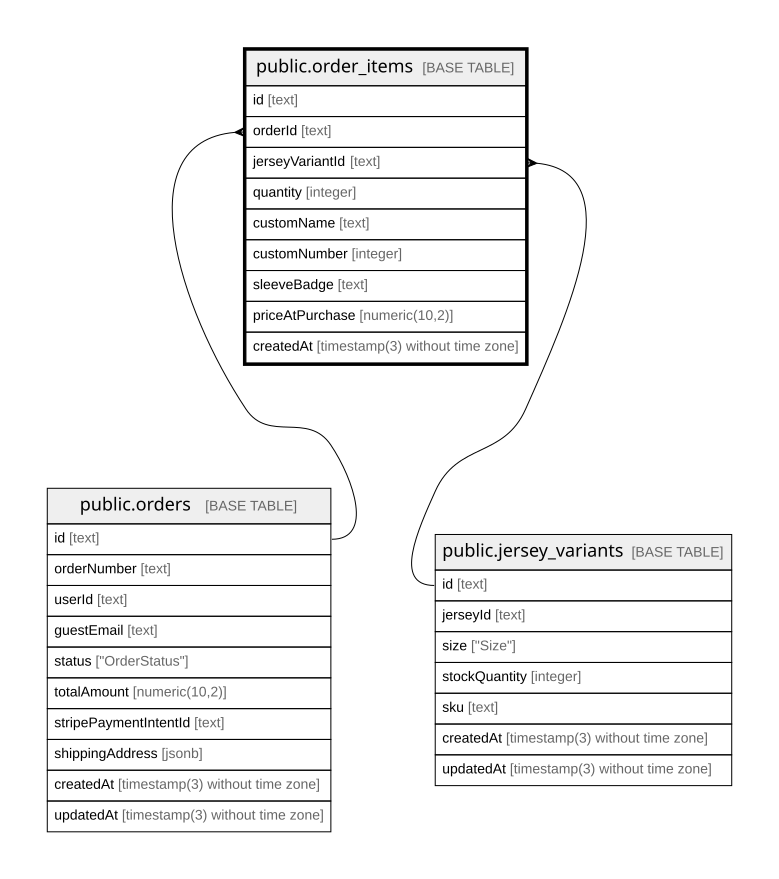

# public.order_items

## Columns

| Name            | Type                           | Default           | Nullable | Children | Parents                                             | Comment |
| --------------- | ------------------------------ | ----------------- | -------- | -------- | --------------------------------------------------- | ------- |
| id              | text                           |                   | false    |          |                                                     |         |
| orderId         | text                           |                   | false    |          | [public.orders](public.orders.md)                   |         |
| jerseyVariantId | text                           |                   | false    |          | [public.jersey_variants](public.jersey_variants.md) |         |
| quantity        | integer                        |                   | false    |          |                                                     |         |
| customName      | text                           |                   | true     |          |                                                     |         |
| customNumber    | integer                        |                   | true     |          |                                                     |         |
| sleeveBadge     | text                           |                   | true     |          |                                                     |         |
| priceAtPurchase | numeric(10,2)                  |                   | false    |          |                                                     |         |
| createdAt       | timestamp(3) without time zone | CURRENT_TIMESTAMP | false    |          |                                                     |         |

## Constraints

| Name                             | Type        | Definition                                                                                          |
| -------------------------------- | ----------- | --------------------------------------------------------------------------------------------------- |
| order_items_jerseyVariantId_fkey | FOREIGN KEY | FOREIGN KEY ("jerseyVariantId") REFERENCES jersey_variants(id) ON UPDATE CASCADE ON DELETE RESTRICT |
| order_items_orderId_fkey         | FOREIGN KEY | FOREIGN KEY ("orderId") REFERENCES orders(id) ON UPDATE CASCADE ON DELETE CASCADE                   |
| order_items_pkey                 | PRIMARY KEY | PRIMARY KEY (id)                                                                                    |

## Indexes

| Name             | Definition                                                                  |
| ---------------- | --------------------------------------------------------------------------- |
| order_items_pkey | CREATE UNIQUE INDEX order_items_pkey ON public.order_items USING btree (id) |

## Relations

---

> Generated by [tbls](https://github.com/k1LoW/tbls)
