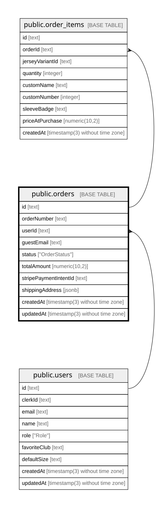

# public.orders

## Columns

| Name                  | Type                           | Default                  | Nullable | Children                                    | Parents                         | Comment |
| --------------------- | ------------------------------ | ------------------------ | -------- | ------------------------------------------- | ------------------------------- | ------- |
| id                    | text                           |                          | false    | [public.order_items](public.order_items.md) |                                 |         |
| orderNumber           | text                           |                          | false    |                                             |                                 |         |
| userId                | text                           |                          | true     |                                             | [public.users](public.users.md) |         |
| guestEmail            | text                           |                          | true     |                                             |                                 |         |
| status                | "OrderStatus"                  | 'PENDING'::"OrderStatus" | false    |                                             |                                 |         |
| totalAmount           | numeric(10,2)                  |                          | false    |                                             |                                 |         |
| stripePaymentIntentId | text                           |                          | true     |                                             |                                 |         |
| shippingAddress       | jsonb                          |                          | true     |                                             |                                 |         |
| createdAt             | timestamp(3) without time zone | CURRENT_TIMESTAMP        | false    |                                             |                                 |         |
| updatedAt             | timestamp(3) without time zone |                          | false    |                                             |                                 |         |

## Constraints

| Name               | Type        | Definition                                                                       |
| ------------------ | ----------- | -------------------------------------------------------------------------------- |
| orders_userId_fkey | FOREIGN KEY | FOREIGN KEY ("userId") REFERENCES users(id) ON UPDATE CASCADE ON DELETE SET NULL |
| orders_pkey        | PRIMARY KEY | PRIMARY KEY (id)                                                                 |

## Indexes

| Name                             | Definition                                                                                                    |
| -------------------------------- | ------------------------------------------------------------------------------------------------------------- |
| orders_pkey                      | CREATE UNIQUE INDEX orders_pkey ON public.orders USING btree (id)                                             |
| orders_orderNumber_key           | CREATE UNIQUE INDEX "orders_orderNumber_key" ON public.orders USING btree ("orderNumber")                     |
| orders_stripePaymentIntentId_key | CREATE UNIQUE INDEX "orders_stripePaymentIntentId_key" ON public.orders USING btree ("stripePaymentIntentId") |
| orders_userId_idx                | CREATE INDEX "orders_userId_idx" ON public.orders USING btree ("userId")                                      |
| orders_status_idx                | CREATE INDEX orders_status_idx ON public.orders USING btree (status)                                          |

## Relations

---

> Generated by [tbls](https://github.com/k1LoW/tbls)
