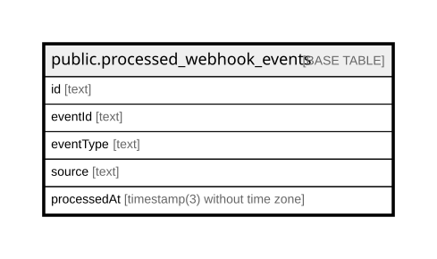

# public.processed_webhook_events

## Columns

| Name        | Type                           | Default           | Nullable | Children | Parents | Comment |
| ----------- | ------------------------------ | ----------------- | -------- | -------- | ------- | ------- |
| id          | text                           |                   | false    |          |         |         |
| eventId     | text                           |                   | false    |          |         |         |
| eventType   | text                           |                   | false    |          |         |         |
| source      | text                           |                   | false    |          |         |         |
| processedAt | timestamp(3) without time zone | CURRENT_TIMESTAMP | false    |          |         |         |

## Constraints

| Name                          | Type        | Definition       |
| ----------------------------- | ----------- | ---------------- |
| processed_webhook_events_pkey | PRIMARY KEY | PRIMARY KEY (id) |

## Indexes

| Name                                 | Definition                                                                                                            |
| ------------------------------------ | --------------------------------------------------------------------------------------------------------------------- |
| processed_webhook_events_pkey        | CREATE UNIQUE INDEX processed_webhook_events_pkey ON public.processed_webhook_events USING btree (id)                 |
| processed_webhook_events_eventId_key | CREATE UNIQUE INDEX "processed_webhook_events_eventId_key" ON public.processed_webhook_events USING btree ("eventId") |

## Relations

---

> Generated by [tbls](https://github.com/k1LoW/tbls)
