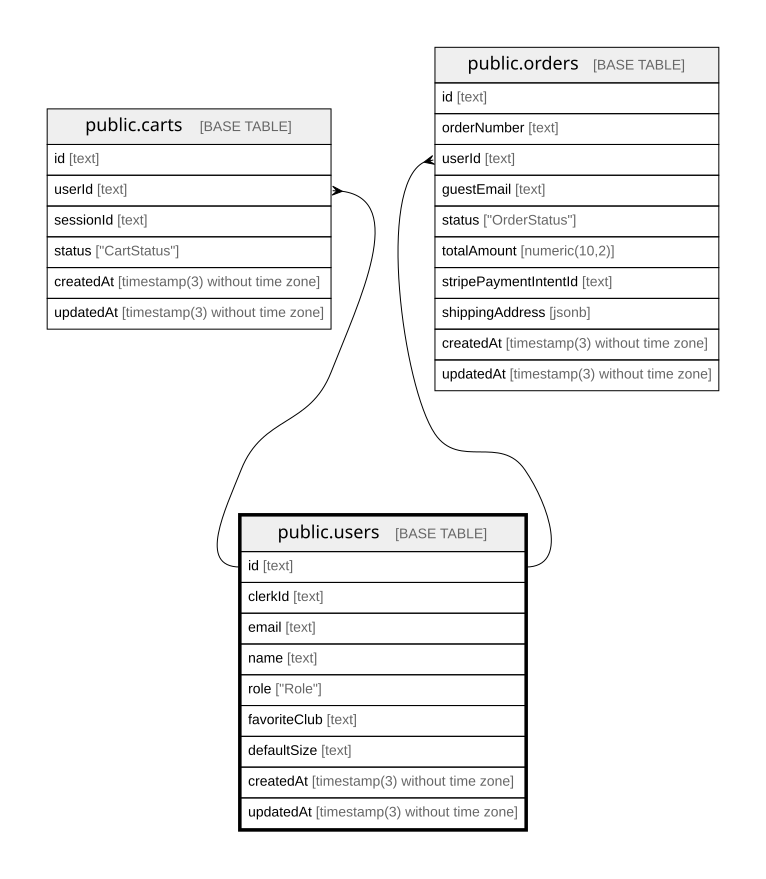

# public.users

## Columns

| Name         | Type                           | Default            | Nullable | Children                                                          | Parents | Comment |
| ------------ | ------------------------------ | ------------------ | -------- | ----------------------------------------------------------------- | ------- | ------- |
| id           | text                           |                    | false    | [public.carts](public.carts.md) [public.orders](public.orders.md) |         |         |
| clerkId      | text                           |                    | false    |                                                                   |         |         |
| email        | text                           |                    | false    |                                                                   |         |         |
| name         | text                           |                    | true     |                                                                   |         |         |
| role         | "Role"                         | 'CUSTOMER'::"Role" | false    |                                                                   |         |         |
| favoriteClub | text                           |                    | true     |                                                                   |         |         |
| defaultSize  | text                           |                    | true     |                                                                   |         |         |
| createdAt    | timestamp(3) without time zone | CURRENT_TIMESTAMP  | false    |                                                                   |         |         |
| updatedAt    | timestamp(3) without time zone |                    | false    |                                                                   |         |         |

## Constraints

| Name       | Type        | Definition       |
| ---------- | ----------- | ---------------- |
| users_pkey | PRIMARY KEY | PRIMARY KEY (id) |

## Indexes

| Name              | Definition                                                                      |
| ----------------- | ------------------------------------------------------------------------------- |
| users_pkey        | CREATE UNIQUE INDEX users_pkey ON public.users USING btree (id)                 |
| users_clerkId_key | CREATE UNIQUE INDEX "users_clerkId_key" ON public.users USING btree ("clerkId") |
| users_email_key   | CREATE UNIQUE INDEX users_email_key ON public.users USING btree (email)         |

## Relations

---

> Generated by [tbls](https://github.com/k1LoW/tbls)
